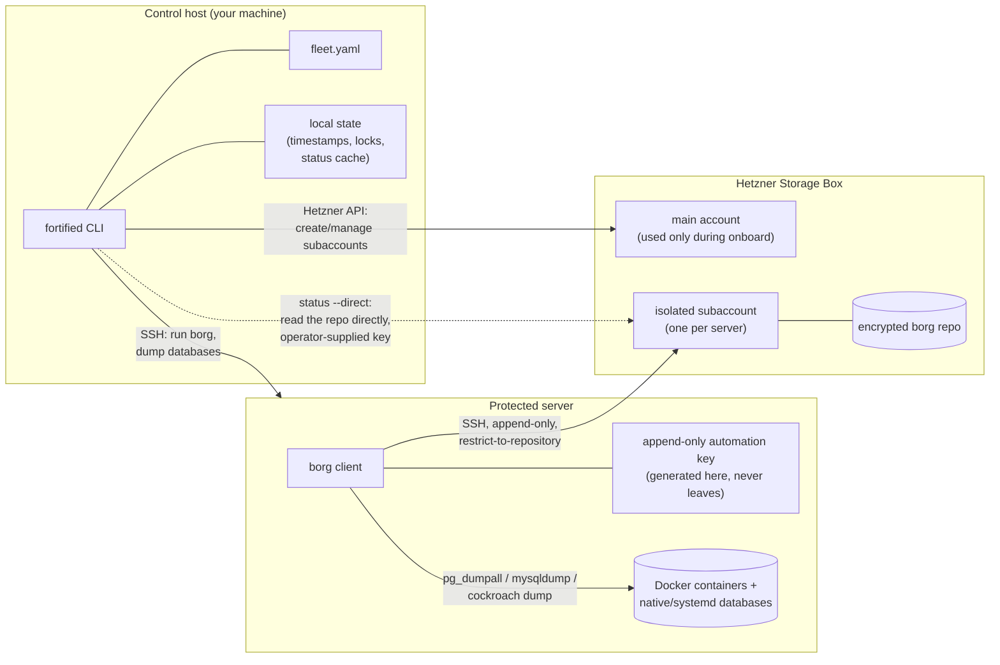
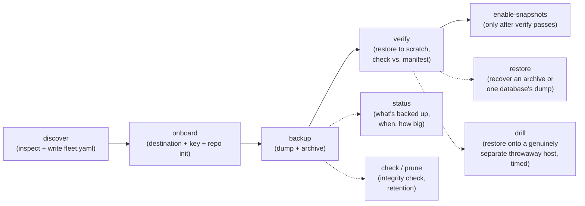

# fortified

**A backup you haven't tried to restore isn't a backup. It's a guess.**

[](https://github.com/danieltamas/fortified/actions/workflows/ci.yml)
[](go.mod)
[](LICENSE)

`fortified` is a deterministic backup and disaster-recovery CLI for a
self-hosted server fleet — Docker containers and native/systemd-installed
databases alike. It provisions an isolated, append-only backup destination on
a Hetzner Storage Box for each server, dumps databases through their own
engine (never raw file copy), archives everything with
[BorgBackup](https://borgbackup.readthedocs.io/), and — the part almost
every backup tool skips — **actually restores the archive and proves it
matches** before it lets you rely on it.

No daemon. No dashboard. No vendor lock-in. One static binary, one YAML file,
and a security model built so that even a fully compromised protected server
can't touch its own backup history.

## At a glance

- **Structurally append-only.** The only key a protected server ever holds
  can push new archives — it cannot delete or overwrite old ones, enforced
  server-side by a forced SSH command, not client-side promises.
- **Verify isn't a checkbox.** `fortified verify` restores the latest
  archive for real and diffs it against a recorded manifest (SHA-256 +
  per-table row counts). Nothing downstream trusts a backup that hasn't
  passed this.
- **Discovers before it assumes.** `fortified discover` inspects a server
  over SSH — containers, databases, exposure, volume manager — and writes
  your config for you. It never guesses what's running.
- **Dual-key discipline.** The one credential capable of *deleting*
  anything (`prune`) is never stored anywhere, ever — supplied by hand,
  out-of-band, only at the moment it's used.
- **Safe to automate.** Every command is `--json`, every mutation is
  `--dry-run`-able, every SSH/HTTP call is audit-logged. See
  [Built to be driven by something else](#built-to-be-driven-by-something-else).
- **Single static binary.** No daemon, no runtime dependency beyond
  `borg` and (optionally) `docker` on the protected server itself.

## Contents

- [Why](#why)
- [Architecture](#architecture)
- [Requirements](#requirements)
- [Installation](#installation)
- [Building](#building)
- [Quick start](#quick-start)
- [Commands](#commands)
- [Configuration (`fleet.yaml`)](#configuration-fleetyaml)
- [Security model](#security-model)
- [Built to be driven by something else](#built-to-be-driven-by-something-else)
- [Project status](#project-status)

## Why

Most backup scripts trust that a `tar` + `scp` job quietly succeeding means
the data is safe. This one doesn't:

- **Discovery before mutation.** `fortified discover` inspects a server's
  real layout over SSH — containers, bind mounts, databases, exposure — and
  writes (or fills in) its `fleet.yaml` entry for you. Nothing is assumed,
  and nothing about an already-onboarded server is ever touched.
- **Isolated, append-only destinations.** Each server gets its own Hetzner
  Storage Box subaccount and its own SSH key, installed with a forced
  command restricting it to `borg serve --append-only`. That key can push
  new archives; it structurally cannot delete or overwrite anything, even
  if the server it lives on is fully compromised.
- **Verify before trust.** `fortified verify` actually restores the latest
  archive into a scratch location and checks it byte- and row-count-correct
  against what was recorded at backup time. Nothing downstream (like
  enabling storage-side snapshots) unlocks until a verify has passed.
- **Real databases, not raw file copies.** Databases are dumped through
  their own engine (`pg_dumpall`, `mysqldump`, `cockroach dump`), never
  copied as raw files off a live data directory — SPEC.md's rule:
  *"database backups must go through the engine, never raw file copy."*
  Postgres, MariaDB, and CockroachDB are supported today, whether running
  in Docker or installed as a native OS package (systemd service) —
  discover detects both, and live-probes each one's actual auth (peer
  auth, TCP with a password, `--insecure`) rather than assuming it works.

None of this is theoretical. The dual-key isolation, the append-only
enforcement, and the retry/timeout handling around a brand-new Storage Box
subaccount were all shaped by running the real thing against a real Hetzner
box and reading its actual error text — not by assuming the docs were
complete. An independent, adversarial security pass (two reviewers plus a
cross-vendor audit) found and closed a real gap in the dual-key model itself
before this went public; see [Security model](#security-model) for what that
model guarantees today, not just what it was designed to.

See [`SPEC.md`](SPEC.md) for the full design rationale. Note: SPEC.md describes
the original v1 design and is ahead of what's actually built in places — see
[Project status](#project-status) below for what's real today.

## Architecture

Three machines are ever involved, and each holds only what it strictly
needs. The control host never holds a key that can talk to a Storage Box
directly — every backup/restore/status operation runs *on* the protected
server, over SSH, using a key that lives only there.



The one deliberate exception is `status --direct`: a genuine disaster-
recovery check ("the origin server is gone — what do I actually have
backed up?") can't ask the origin about itself, so it talks to the Storage
Box straight from the control host using a key *you* supply for that one
invocation. `fortified` never generates, copies, or persists a key for
this — every other command's key custody is unchanged.

### Command lifecycle



## Requirements

- A Hetzner Cloud API token and a Hetzner Storage Box (the main account's
  own SSH credentials, not the token, are what `onboard` uses to install
  each server's isolated key).
- `borg` on each protected server (`onboard` auto-installs it via
  apt/dnf/yum/apk if missing) — and on the control host too, but only if
  you use `prune` (see [Security model](#security-model) for why that one
  command is deliberately exempt from the rest of the topology).
- Docker on each protected server, for any container-based database dumps.
- No Go toolchain is required to *run* fortified once built — see
  [Building](#building) for how it's actually compiled in this repo.

## Installation

Prebuilt, statically-linked binaries (linux/amd64, linux/arm64, darwin/amd64,
darwin/arm64) are attached to every
[release](https://github.com/danieltamas/fortified/releases):

```
curl -L https://github.com/danieltamas/fortified/releases/latest/download/fortified_<version>_<os>_<arch>.tar.gz \
  | tar -xz fortified
sudo mv fortified /usr/local/bin/
```

On macOS, `codesign --sign - --force` the binary first (Apple Silicon refuses
to run an ad-hoc-unsigned cross-compiled binary otherwise — see
[Building](#building)). No Go toolchain, Docker, or anything else is required
to just run it; see below only if you want to build from source.

## Building

This repo assumes no Go toolchain on the operator's own machine — every
`just` recipe runs inside a Docker dev image instead:

```
just build-image   # build the fortified-dev Docker image (borg, docker CLI, golangci-lint)
just check         # gofmt -l, go vet, golangci-lint, build, go test — must pass before every commit
just test          # go test ./...
just build          # CGO_ENABLED=0 go build -trimpath -o bin/fortified ./cmd/fortified (Linux target)
```

The default build target is `GOOS=linux CGO_ENABLED=0` — fortified is meant
to run on the control host, assumed Linux. Cross-compiling for macOS is a
manual, one-off step, not a `just` target:

```
docker run --rm -v "$(pwd)":/src -w /src fortified-dev \
  bash -c 'GOOS=darwin GOARCH=arm64 CGO_ENABLED=0 go build -trimpath -o /src/fortified-darwin-arm64 ./cmd/fortified'
codesign --sign - --force ./fortified-darwin-arm64   # required on Apple Silicon, or the binary exits 137 with no error text
```

See [`TESTING.md`](TESTING.md) for the full testing strategy (argv-level
unit tests, golden-file tests, local integration tests against real
Postgres/MariaDB/CockroachDB containers, and an operator-gated live tier).

## Quick start

```
# 1. Inspect a server and add it to fleet.yaml — writes/merges the entry
#    directly, auto-resolving the destination if the rest of your fleet
#    already agrees on one Storage Box. Only a genuinely unresolvable
#    field (e.g. a database's auth) is left for you to fill in, in a
#    separate <server>.pending.yaml draft — an already-onboarded server
#    is never touched by a re-run.
fortified discover my-server --host 203.0.113.5

# 2. Provision the isolated destination and append-only key
fortified onboard my-server --escrow-acknowledged

# 3. Run a backup (this is what cron calls nightly)
fortified backup my-server

# 4. Prove the backup is actually restorable
fortified verify my-server

# 5. Only after verify passes: turn on the destination's own snapshot schedule
fortified enable-snapshots my-server

# Anytime: see what's actually in the repo
fortified status my-server

# Across the whole fleet, instantly (reads each server's last-cached
# status — pass --live to contact every server directly instead)
fortified status --all
```

`fortified backup --all` runs every configured server sequentially and
exits non-zero if any of them failed — this is the one command a cron
entry's alerting should hang off of. Representative output (composited from
real runs; exact durations/sizes vary):

```
$ fortified backup web-1
confirming destination... done (1.0s)
resolving database auth and archive paths... done (0s)
staging 1 database dump(s) and creating the archive...
dumping psql: done (4.2s)
creating archive 2026-07-29T21-12-01Z: done (6.1s)
web-1: backup complete.

$ fortified verify web-1
listing archives... done (0.3s)
restoring archive 2026-07-29T21-12-01Z... done (2.8s)
verifying psql (checksum + row counts via a throwaway container)... done (1.1s)
web-1: verify passed — SHA-256 and row counts match the recorded manifest.
`fortified enable-snapshots` is now unlocked for this server.

$ fortified status web-1
FIELD                            VALUE
repo initialized                 true
last backup                      2026-07-29T21:12:06Z
last passing verify              2026-07-29T21:15:40Z
archives                         5
repo total size (deduplicated)   938.5 MB
```

## Commands

All commands accept `--json` (persistent flag) to render output as JSON
instead of a table, and `--config` to point at a `fleet.yaml` other than
the default `~/.config/fortified/fleet.yaml`.

| Command | What it does |
|---|---|
| `discover <server-id>` | Inspects a target server over SSH (read-only): containers, bind mounts, databases, volume manager, RAID, exposure, crontab, SSH/TLS/tunnel config. Writes or fills in the server's `fleet.yaml` entry directly — auto-resolving the Storage Box destination when the rest of the fleet already agrees on one, prompting with a live-fetched list otherwise. Never touches an already-onboarded server's config. `--emit-config` prints a stanza to stdout instead, for scripting. `--refresh-databases` updates only an already-onboarded server's known-database list in local state (e.g. a database container added after onboarding) without touching config, keys, or the repo. |
| `onboard <server-id>` | Provisions the server's isolated Hetzner Storage Box subaccount, installs its append-only automation key, and initializes the encrypted Borg repo. Requires `--escrow-acknowledged` to reach the repo-init step — see [Passphrase escrow](#security-model). Resumable: re-running picks up from the last completed step. |
| `backup [server-id]` | Stages every configured database's dump (checksummed as it goes), then creates a new Borg archive. `--all` runs every configured server instead of one. Prints live upload progress and a summary of what was backed up when it finishes, and refreshes that server's status cache. |
| `verify <server-id>` | Restores the latest archive into a scratch location and proves it matches the manifest recorded at backup time (SHA-256 + per-table row counts) — not just "extraction didn't error." |
| `check <server-id>` | Runs Borg's own repo integrity check. Should be run (and pass) before any `prune`. |
| `restore <server-id>` | Extracts an archive — or, with `--db`, just one database's own dump file — into a directory on the target. Run without `--archive` to list the repo's archives instead. Refuses a non-empty target or a path that's a live database's own data mount. |
| `prune <server-id> --prune-key <path>` | Enforces the configured retention policy, using the separate unrestricted key (never cached or read from config — supplied explicitly every time). Dials the Storage Box directly from the control host, never through the protected server — the one command where that matters (see [Security model](#security-model)). Runs `check` first automatically and refuses to prune a repo that just failed it. Permanently deletes archives, so it prompts for a typed `yes` confirmation before running — pass `--yes-i-mean-it` to skip the prompt for scripted/cron use. |
| `enable-snapshots <server-id>` | Turns on the destination's native snapshot schedule. Refuses unless a `verify` has already passed for that server. |
| `status [server-id]` | Every archive in the repo, the latest one's size, the repo's total deduplicated size, per-database/schema sizes, per-configured-path sizes, and the locally-recorded last-backup/last-verify timestamps. Also surfaces a loud warning if a server's automation key may currently be unrestricted (see [Security model](#security-model)). `--all` shows one compact row per configured server, reading each one's last-cached status by default (instant, no SSH) — pass `--live` to contact every server directly instead. `--direct <key-path>` bypasses the target entirely to read the Storage Box straight from the control host — for when the origin server itself is gone (see [Architecture](#architecture)). |
| `drill <server-id> --target <host> --identity <key-path> --into <path>` | Proves a backup is actually recoverable by restoring it onto a genuinely separate throwaway host, timed. Never touches the server being drilled — only the Hetzner API (to find its destination) and an operator-supplied key already authorized to read the repo. Records a passing drill in local state. |
| `audit-keys <server-id>` | Lists every SSH key authorized on the server's isolated destination. `--remove <comment>` removes one by its exact comment — refuses to remove fortified's own automation key. |
| `settings` | Opens `fleet.yaml` in `$VISUAL`/`$EDITOR` (falls back to `nano`) so you can edit the scanned/onboarded fleet directly. Warns (doesn't fail) if the file no longer loads cleanly after you save. |
| `rename <old-server-id> <new-server-id>` | Syncs an already-onboarded server's Storage Box subaccount (name and home directory) and local state (record, lock, audit log, cached status) to a server ID you already changed in `fleet.yaml` — every other command re-derives both from the current server ID on every call, so editing `fleet.yaml` alone silently strands them under the old name. Idempotent: safe to re-run, and safe to run after fixing one side by hand. |
| `version` | Prints the fortified version. |

`onboard`, `backup`, `verify`, `check`, `restore`, `prune`, and
`enable-snapshots` all accept `--dry-run` and `--wait` (block until a
concurrent run's per-server lock is free, instead of failing fast). For
`onboard`/`backup`/`verify`, `--dry-run` is a coarse, command-level summary
rather than a per-step plan — each dumps immediately read back what they
just wrote to build the verification manifest, so there's no meaningful way
to preview only the non-mutating half. `enable-snapshots --dry-run` is
finer-grained: it's a single real API call with no interleaved read-back to
skip around.

## Configuration (`fleet.yaml`)

Full field reference: [`internal/config/schema.md`](internal/config/schema.md).

```yaml
servers:
  my-server:
    ssh:
      host: 203.0.113.5
      port: 22
      user: root
    provider: hetzner
    destination: "433593"        # Hetzner Storage Box ID
    archive:
      - path: /etc/nginx
      - path: /home/myapp
        glob: "*/docker-compose.yml"   # optional
    databases:
      - kind: postgres
        container: psql
        dump_strategy: docker-exec
      - kind: mariadb
        container: mysql
        dump_strategy: docker-exec
        auth_ref: secret://fortified/my-server/mariadb-root  # only if discover
                                                                # couldn't auto-resolve it
      - kind: cockroachdb
        container: crdb
        dump_strategy: docker-exec
      - kind: postgres
        container: postgresql  # synthetic name — installed as a native
        dump_strategy: native  # OS package (systemd service), not Docker
    encryption_key_ref: env://BORG_PASSPHRASE_MY_SERVER
    hetzner:
      main_account:
        host: uXXXXXX.your-storagebox.de
        port: 23
        user: uXXXXXX
      hcloud_token_ref: env://HCLOUD_TOKEN
    retention:                    # optional — defaults shown
      keep_daily: 7
      keep_weekly: 4
      keep_monthly: 6
    workspace_dir: /mnt/some-volume  # optional — stage dumps under this
                                       # absolute path instead of the SSH
                                       # login's own home directory, when a
                                       # database's dump needs more scratch
                                       # space than the root filesystem has free
```

Secrets are always references, never literal values — `config.Load` refuses
a document containing a plaintext secret or a leftover `TODO`:

- **`env://VAR`** — reads an environment variable on the control host. No
  external dependency, always available.
- **`secret://path/to/name`** — resolved via the
  [Infisical](https://infisical.com/) CLI. Requires Infisical's own ambient
  auth/project context already configured on the control host; fortified
  doesn't manage that itself.

`discover` writes this file for you (see [Commands](#commands)) — you
should rarely need to hand-write a `servers:` entry from scratch.

## Security model

- **Dual-key discipline, actually enforced end to end.** The only credential
  fortified installs on a protected server is an append-only automation key,
  generated on that server and never copied elsewhere. A separate,
  unrestricted key capable of deleting old archives (needed for `prune`) is
  never stored by fortified at all — it's supplied by the operator
  out-of-band, via `--prune-key`, only when actually pruning, and `prune`
  dials the Storage Box directly from the control host rather than routing
  through the protected server's own session — so that key is never even
  momentarily readable from a server it could be used to compromise.
- **Append-only enforcement is server-side, not client-side trust.** The
  automation key's `authorized_keys` entry carries a forced command:
  `command="borg serve --append-only --restrict-to-repository <path>",restrict <pubkey>`.
  Even a fully compromised protected server can only append new archive
  data through that key — never delete or modify existing backups.
  `onboard` verifies this restriction actually took effect (a plain SFTP
  attempt with the new key must be refused, and a network failure that
  never even reaches the server doesn't count as confirmation) rather than
  assuming it. If an interrupted `onboard` run ever leaves a key
  temporarily unrestricted, `status` surfaces that loudly rather than
  staying silent about it.
- **Passphrase escrow.** `onboard` refuses to initialize the encrypted
  repo without `--escrow-acknowledged` — a deliberate confirmation that the
  repo's encryption passphrase has been copied somewhere durable and
  independent of the server itself. A repo whose only passphrase copy lived
  on the server that was just lost isn't a backup. If the referenced
  `env://` variable is simply unset, `onboard --escrow-acknowledged` offers
  to generate a strong passphrase on the spot, print it once for you to
  save, and continue the same run with it.
- **Control host as single point of failure — deliberately narrow.**
  Timestamps, locks, and the `status --all` cache only ever exist on the
  control host's local state (`~/.config/fortified/state/`) — losing the
  control host loses that bookkeeping, not the backups themselves, and
  `discover`/`onboard` can reconstruct `fleet.yaml` and repo access from
  scratch. The control host also never holds a key capable of talking to
  a Storage Box directly; every command proxies through the protected
  server's own automation key, except `prune` and `status --direct`'s
  explicit, never-persisted exceptions (see [Architecture](#architecture)).

This model has been through an adversarial pass on purpose: an in-session
review plus an independent, cross-vendor audit (a different model auditing
the same code, specifically so one vendor never both writes and grades its
own work) found and fixed a real violation of the dual-key guarantee above
before this repo went public — `prune` used to be wired through the
protected server's own SSH session, which would have required the
unrestricted key to be readable from exactly the machine it exists to be
safe from. It's called out here, not swept under the rug, because "we got
audited and fixed what it found" is a more honest claim than "we designed
it right the first time."

## Built to be driven by something else

The reason it's usually risky to let something automated — a script, a cron
job, an AI agent — touch backup infrastructure is blast radius: if it's
wrong, it can delete your only copy. fortified is deliberately built so that
the catastrophic outcomes are structurally unreachable through the surface
anything automated would actually drive:

- Every command emits `--json` — something else can reason over facts, not
  scrape a table.
- Every mutating command supports `--dry-run` — a human or a second system
  can review a plan before it runs for real.
- Every SSH and HTTP call is written to a local audit log
  (`internal/audit`), so what actually happened is independently
  checkable afterward, not just whatever a summary claims.
- The one key anything routine ever holds is append-only, enforced by the
  server, not by whoever's driving the CLI behaving well. The key capable
  of deleting anything is never held by the automated path at all — see
  [Security model](#security-model).

Put together: a script, a cron job, or an AI coding agent driving `fortified
backup` / `verify` / `status` can create backups and prove them restorable.
It cannot delete backup history, because the credential that could isn't
reachable from anything but a human typing `--prune-key` by hand. That's a
narrower, more honest claim than "safe for AI" usually means — no
prompt-engineering required, because the guardrail isn't a prompt.

There's no MCP server or agent wrapper shipped yet; the properties above are
what one would be built on top of.

## Project status

Implemented and in live use: `discover` (including `--refresh-databases`),
`onboard`, `backup`, `verify`, `check`, `restore`, `prune`,
`enable-snapshots`, `status` (including `--all`/`--live`/`--direct`),
`drill`, `audit-keys`, `settings`, `rename`. Postgres, MariaDB, and
CockroachDB are all supported database engines. If you're looking at
SPEC.md and a command described there doesn't appear in
[Commands](#commands) above, it isn't built yet.

## License

[MIT](LICENSE) — free to use, modify, and redistribute, with attribution.
